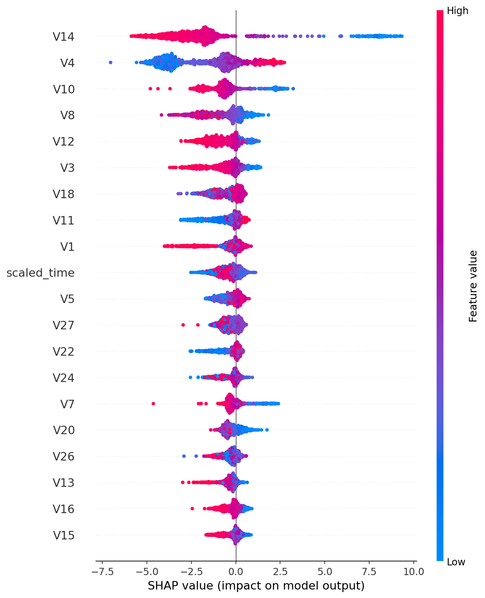

# Credit Card Fraud Detection (XGBoost + SMOTE)

A machine learning project to detect fraudulent credit card transactions while keeping false alarms low. Built on a highly imbalanced dataset (~0.17% fraud) using Logistic Regression and XGBoost, with SMOTE for class balancing and Precision-Recall AUC as the main metric.

## Dataset

- **Source:** [Kaggle - Credit Card Fraud Detection (ULB)](https://www.kaggle.com/datasets/mlg-ulb/creditcardfraud)
- 284,807 transactions, 31 columns: `V1`-`V28` (PCA-transformed features), `Time`, `Amount`, `Class` (0 = normal, 1 = fraud)
- Only ~0.17% of transactions are fraud (severe class imbalance)
- The CSV is **not included** in this repo (file size). Download it from Kaggle and place it at `data/creditcard.csv`.

## Tech Stack

Python 3.10, pandas, numpy, scikit-learn, imbalanced-learn, xgboost, matplotlib, seaborn, Jupyter

## Project Structure

```
fraud-detection-system/
├── data/            # creditcard.csv goes here (not tracked)
├── notebooks/       # 01_eda.ipynb
├── src/             # scripts (coming soon)
├── models/          # saved models (coming soon)
├── requirements.txt
└── README.md
```

## Pipeline

1. **EDA** - visualize class imbalance
2. **Train-test split** - stratified 80/20, so both sets keep the same fraud ratio
3. **Scaling** - `StandardScaler` on `Amount` and `Time` (fit on train only, transform on test)
4. **Baseline** - Logistic Regression
5. **XGBoost** - default settings
6. **Hyperparameter tuning** - `RandomizedSearchCV` (20 candidates x 3-fold CV), with SMOTE inside an `imblearn` Pipeline so it is applied only to each fold's training portion
7. **Threshold optimization** - threshold chosen on out-of-fold training predictions (F1-maximizing), then evaluated once on the test set
8. **Explainability** - SHAP / feature importance *(planned)*

## Results

Evaluated on the untouched test set (56,962 transactions, 98 frauds).

| Model | Test PR-AUC |
|---|---|
| Logistic Regression (baseline) | ~0.77 |
| XGBoost (default) | ~0.88 |
| XGBoost (tuned, SMOTE inside Pipeline) | 0.880 |

**Best hyperparameters found:** `n_estimators=200`, `max_depth=9`, `learning_rate=0.2`, `subsample=0.9`, `colsample_bytree=0.8`, `scale_pos_weight=1`

**Threshold tuning (tuned XGBoost):**

| Threshold | Precision | Recall | F1 |
|---|---|---|---|
| 0.5 (default) | 0.792 | 0.857 | 0.824 |
| 0.978 (F1-optimized) | 0.940 | 0.796 | 0.862 |

Raising the threshold cuts false alarms sharply but misses a few more frauds. The right choice depends on the relative cost of a missed fraud vs. a false alert.

**Honest takeaways**
- Hyperparameter tuning did not improve PR-AUC over default XGBoost; the difference is within noise.
- The test set has only 98 fraud cases, so small metric differences are not strongly reliable.
- The high threshold (0.978) reflects SMOTE-inflated probabilities, not a literal "98% sure".

## Key Learnings

- Accuracy is misleading on imbalanced data; use Precision, Recall, F1 and PR-AUC.
- Apply SMOTE and scaling fit **only on training data** to avoid data leakage.
- Applying SMOTE *before* cross-validation leaks synthetic copies across folds and inflates CV scores (my first run showed CV PR-AUC 0.9999 vs test 0.866). Fix: put SMOTE inside an `imblearn` Pipeline.
- Choose the decision threshold on training/validation data, not the test set.

## How to Run

```bash
# 1. Clone the repo
git clone https://github.com/Novash-091/credit-card-fraud-detection.git
cd credit-card-fraud-detection
# 2. Create and activate a virtual environment (Windows PowerShell)
python -m venv venv
venv\Scripts\activate

# 3. Install dependencies
pip install -r requirements.txt

# 4. Download creditcard.csv from Kaggle into data/

# 5. Open the notebook
jupyter notebook notebooks/01_eda.ipynb
```

## Roadmap

- [x] EDA and preprocessing
- [x] Baseline and XGBoost models
- [x] Hyperparameter tuning (leak-free CV)
- [x] Threshold optimization
- [x] Feature importance / SHAP explainability
- [ ] Compare more models (Random Forest, class-weight approach)
- [ ] Move notebook code into `src/` scripts
- [x] Save final model in `models/`
- [ ] Optional: simple Streamlit demo


## Explainability

I used XGBoost's built-in importance and SHAP values to understand which features drive predictions.


- **V14** is the dominant feature, followed by **V4, V10, V12 and V8**.
- Low values of V14, V10, V12 and V3 push the prediction towards fraud; high values of V4 and V11 do the same.
- Features `V1`-`V28` are anonymized PCA components, so these patterns cannot be mapped to real transaction attributes.
- The SHAP sample was fraud-enriched (all 98 test frauds + 1,000 random normal rows), and the model relies heavily on V14, which could be a weakness if fraud patterns shift over time.

## Author

Novash - [GitHub](https://github.com/Novash-091)
